# Gaz Express — Architecture Diagrams

| Field | Value |
|---|---|
| **Document type** | Architecture diagram pack |
| **Notation** | Mermaid |
| **Viewpoint model** | C4-inspired (Context → Containers → Components) + runtime sequences + state + deployment |
| **Companion** | [`ARCHITECTURE.md`](./ARCHITECTURE.md) 
| **Program** | Project 2025 · Gaz Express |

> Render tip: open in GitHub, VS Code, or any Mermaid-compatible viewer.

---

## Diagram index

| ID | Diagram | Viewpoint |
|---|---|---|
| D-01 | System context | C4 Level 1 |
| D-02 | Container diagram | C4 Level 2 |
| D-03 | Zone dispatch engine | Logical capability |
| D-03b | Planning vs execution (assignment model) | Runtime |
| D-03c | Conflict-prevention invariants | Logical capability |
| D-04 | Order lifecycle state | Behavioral |
| D-05 | Customer checkout sequence | Runtime |
| D-06 | Agent fulfillment sequence | Runtime |
| D-07 | Admin operational control | Runtime |
| D-08 | Mobile clean architecture | C4 Level 3 (client) |
| D-09 | Mobile role shells | Application structure |
| D-10 | Client network & session | Component |
| D-11 | Deployment topology | Physical / ops |
| D-12 | Product evolution (v1 → v3) | Roadmap |

---

## D-01 — System context (C4 Level 1)

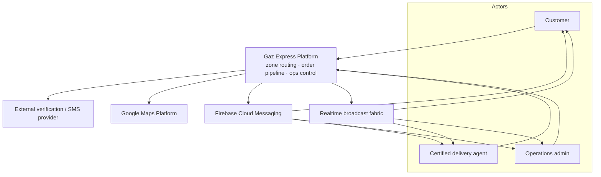

**Intent:** System boundary, human actors, and external dependencies that affect continuity.

---

## D-02 — Container diagram (C4 Level 2)

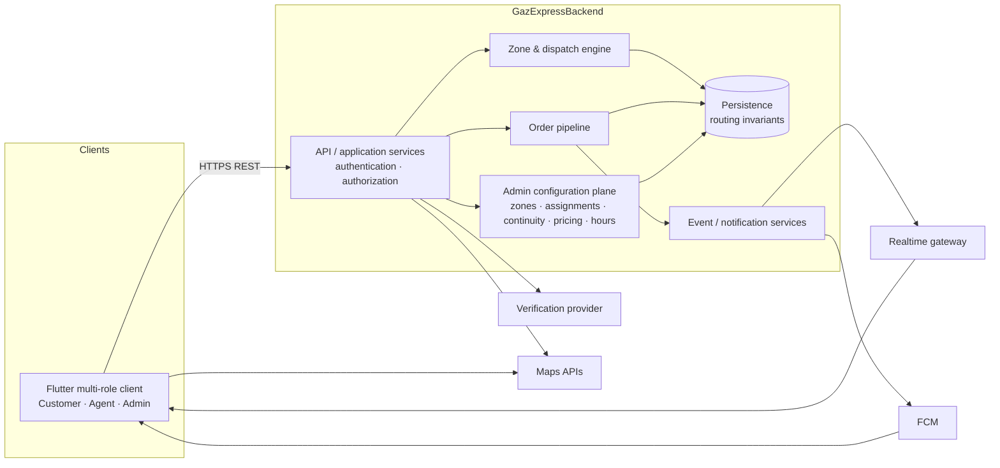

**Intent:** Persistence is the integrity boundary for routing; the API layer is the authorization boundary.

---

## D-03 — Zone dispatch engine (logical)

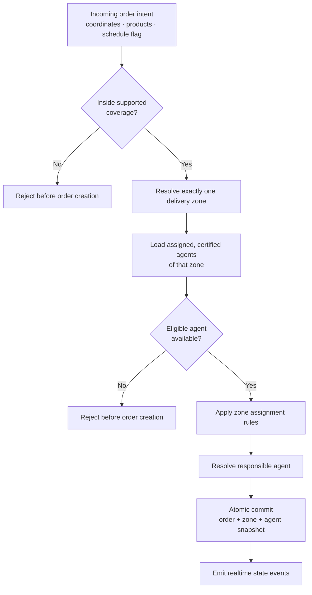

**Design notes**

- Zones and assignments are admin-managed configuration, not client logic.
- Zone is resolved once; the result is stored with the order.
- Same zone configuration and agent state produce the same routing outcome.

---

## D-03b — Planning vs execution (assignment model)

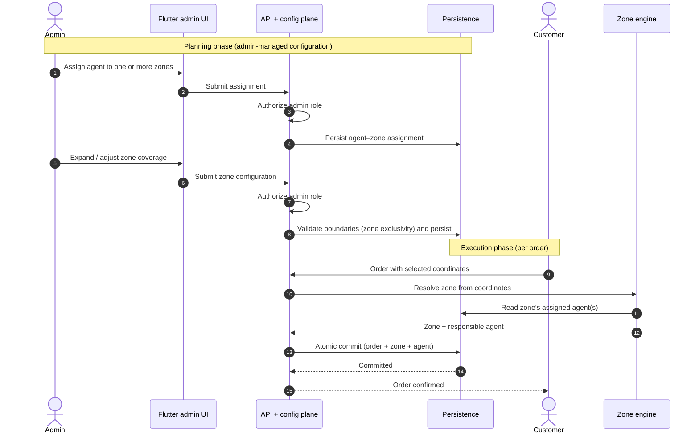

---

## D-03c — Conflict-prevention invariants

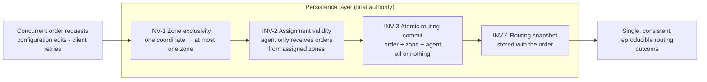

**Intent:** Show that conflict prevention is a property of the persistence layer, independent of client behavior.

---

## D-04 — Order lifecycle (simplified state)

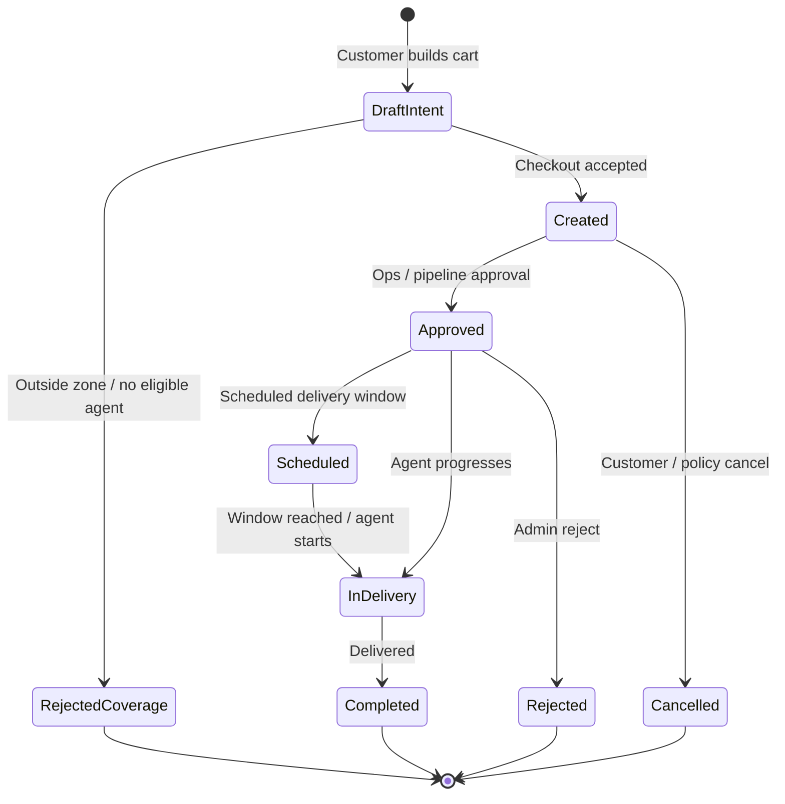

**Note:** Status vocabulary is owned by backend enums; clients map API states into role queues.

---

## D-05 — Customer checkout sequence

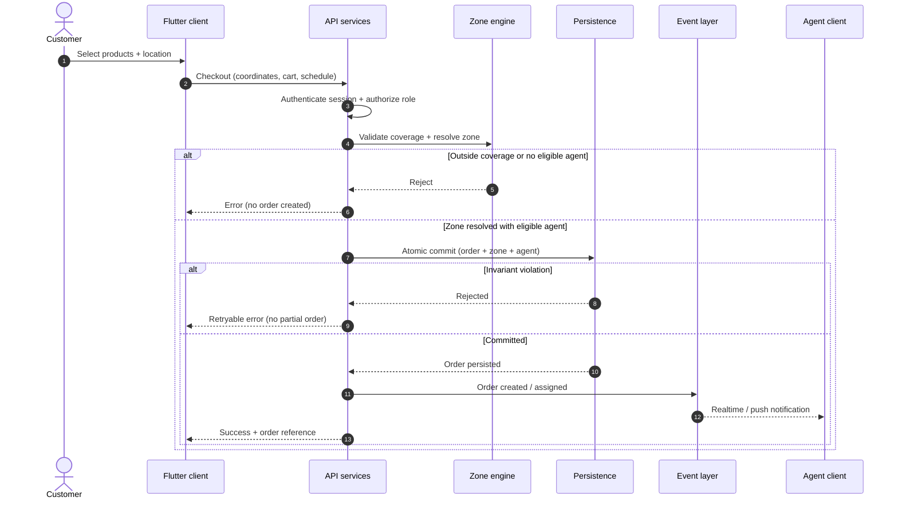

---

## D-06 — Agent fulfillment sequence

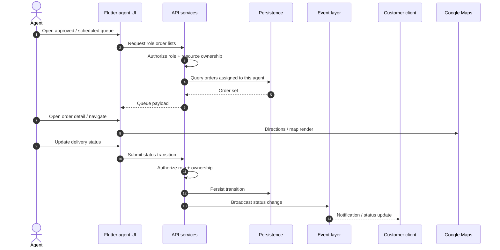

---

## D-07 — Admin operational control

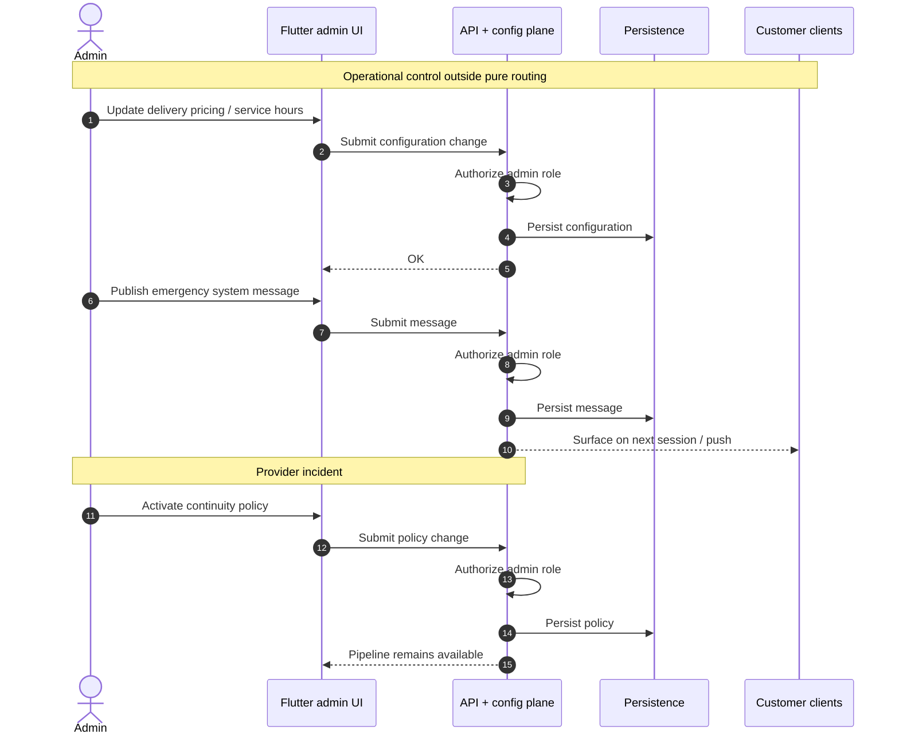

---

## D-08 — Mobile clean architecture (C4 Level 3)

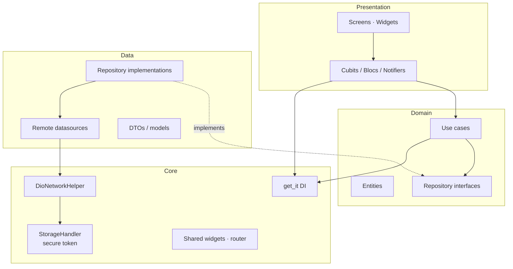

**Dependency rule:** Presentation → Domain ← Data; Core is shared infrastructure.

---

## D-09 — Mobile role shells

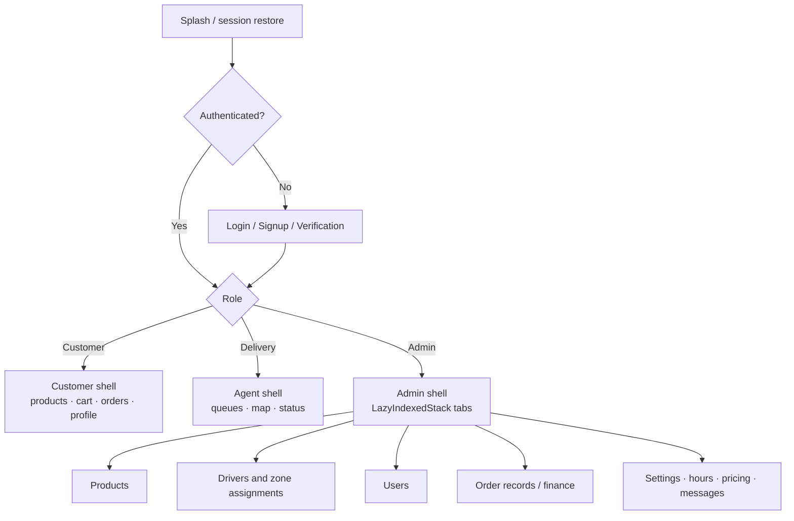

**Note:** Role routing on the client is UX only. Authorization is enforced by the backend on every privileged request.

---

## D-10 — Client network & session cross-cutting

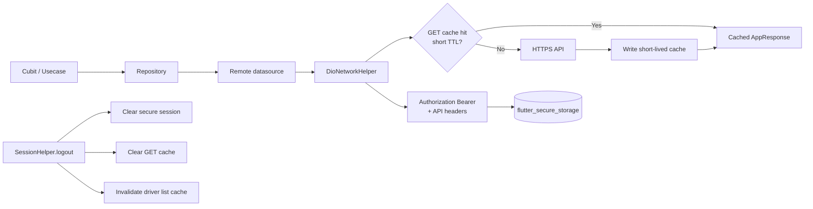

---

## D-11 — Deployment topology

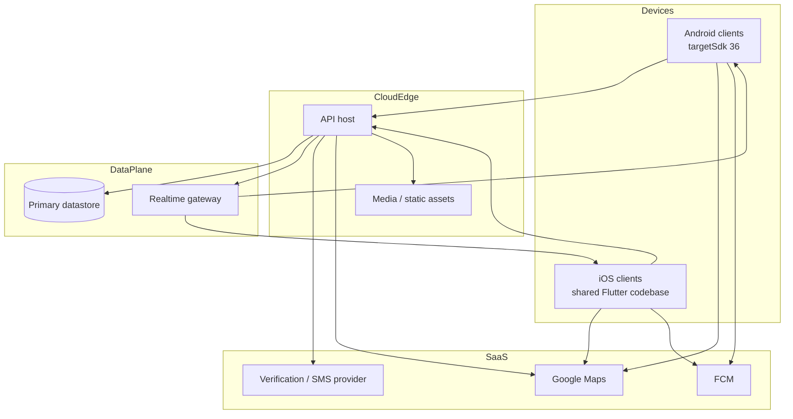

> **Build tooling (not a runtime container):** the Flutter client may be **analyzed, tested, and APK-built** via Docker (`Dockerfile` / `docker-compose.yml`). That path does not appear above because it is a developer/CI concern, not a production deployment node. See [`DOCKER.md`](./DOCKER.md).

---

## D-12 — Product evolution (v1 → v3)

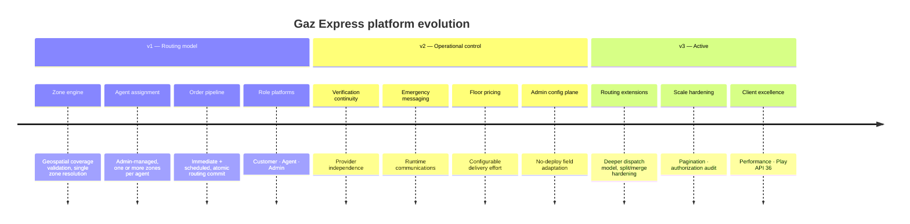

---

## Quality checklist for diagram consumers

| Check | Expected |
|---|---|
| Who defines agent–zone assignment? | Admin, through configuration |
| Where is dispatch truth? | Persistence / zone engine, not the Flutter UI |
| Can two zones claim one coordinate? | No (INV-1) |
| Can an order be partially assigned? | No (INV-3) |
| Does a config change alter existing orders? | No (INV-4) |
| Where is authorization enforced? | Backend API layer (role + ownership) |
| What is this repo? | Multi-role Flutter container, not the zone engine |

---

## Document control

| Item | Value |
|---|---|
| Source of truth for visuals | This file |
| Narrative architecture | [`ARCHITECTURE.md`](./ARCHITECTURE.md) |
| Update triggers | New containers, trust-boundary changes, v3 routing extensions |

---

*End of diagram pack.*
